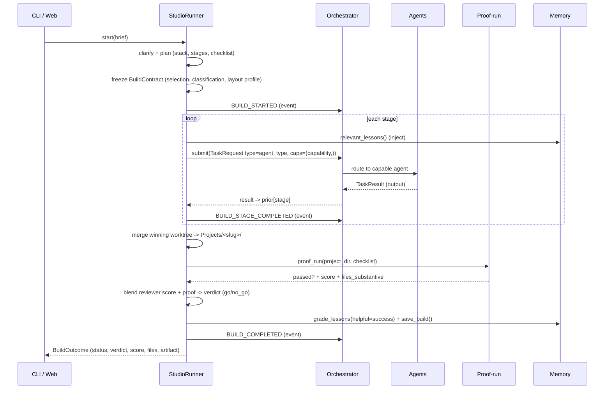

# SkyN3t 2.0 — Architecture

SkyN3t is an **event-sourced, capability-routed multi-agent factory**. A single
`EventBus` is the backbone; an `Orchestrator` routes capability-tagged tasks to
specialized agents; a `Studio` pipeline turns a brief into a delivered project;
a memory store closes the learning loop. Every layer degrades independently so
the system always imports and always runs.

## Package map

| Package | Responsibility |
| --- | --- |
| `skyn3t.config` | `Settings`/`get_settings` — typed config anchored to the repo root; safe defaults; `.env` loading. |
| `skyn3t.core` | The spine: `events` (EventBus/Event/EventType), `agent` (BaseAgent + task types), `orchestrator` (routing, concurrency, self-heal), `model_router` (tier -> model). |
| `skyn3t.adapters` | `llm` — `LLMClient` (`auto`, `stub`, `openrouter`, `codex_cli`, `kimi_cli`, `copilot_cli`, and policy-allowed `claude_cli`) with `BudgetTracker`/`BudgetExceeded`. `auto` uses signed-in local CLIs first and reaches OpenRouter only with explicit consent. |
| `skyn3t.agents` | One module per agent, registered by capability (brainstorm, research, architect, designer, code, code_improver, reviewer, critic, writer, verifiers, test_author, packaging, deploy, browser, github_*). |
| `skyn3t.studio` | `runner` (brief->app pipeline), `planner`, `stages`, `best_of_n`, `proof_run`, `manifest`, `approval_gate`, `clarification`. |
| `skyn3t.memory` | `store` (tasks/builds/lessons over SQLite), `models`, `ingestor`, plus consciousness/hygiene/tuner/meta-agent helpers. |
| `skyn3t.rag` | Knowledge corpus: `rag_engine`, `document_processor`, `embeddings`, `vector_store`, `retrieval`, `repo_map`. |
| `skyn3t.cortex` | Autonomous loop, proposal store, repo scout, prompt/tuning stores, an isolated verification-gated code candidate engine, and evidence-only configuration evaluation records. |
| `skyn3t.intelligence` | Debate, reflection, learning loop, model tournament, skill library, build patterns. |
| `skyn3t.web` | FastAPI control plane (`app`, `routes`, `websockets`, `deps`) — optional, loopback-safe. |
| `skyn3t.cli` | `main` — the Typer CLI (this package). |
| `skyn3t.security` / `observability` / `persistence` / `registry` / `integrations` / `self_healing` | Cross-cutting: sandbox hardening, metrics, durable state, agent registry, external connectors, recovery. |
| `skyn3t.worktree` | Isolated build worktrees + merge-back delivery. |

## Build dataflow

Key invariant: a build is only `completed` when delivered files are non-empty
**and** substantive (`delivered != empty`). Best-of-N runs the code stage in
parallel worktrees and merges the winner before delivery.

Parallel code slices share a read-only file manifest and write only their owned
paths. MCP slices receive the same SDK/dependency contract as the whole-project
builder, including on resume. Failed live slices preserve partial output without
inventing placeholder configuration or tests; scaffold placeholders are limited
to the offline path, and incomplete slices remain explicitly degraded. The
repair loop targets configuration files as well as source files, normalizes
project-local absolute diagnostic paths, and reports failure when it cannot
locate any repair target instead of reporting an empty success.

### MCP integration reliability

MCP planning, generation, test-authoring and repairs share an external-service
contract: boot/list without credentials, fail authenticated operations explicitly
when configuration or upstream requests fail, and never replace errors with demo
data. Live MCP architecture gets one malformed-plan correction attempt; a second
failure is degraded, not an undisclosed offline scaffold.

The MCP gate retains protocol-only checks for local tools. Detected HTTP integrations
also run isolated 401, 503 and timeout probes through supported `httpx`, `requests`
and `urllib.request` clients. Each tool/fault records request count and result;
unsupported clients or faults with no exercisable request are unavailable, not
passes. Synthetic credentials, isolated HOME/state and blocked Python socket/process
operations keep these probes offline. A separate handshake/list pass clears declared
credential environment variables so diagnostic credentials cannot hide a startup
dependency. This diagnostic harness is **not an OS sandbox**.
Coverage is bounded; it does not establish correct vendor endpoints, complete
happy-path behavior, or successful live tenant operations.

Failed or unavailable MCP checks withhold GO, including in lab posture. Evidence
is bound to authored-source snapshots and refreshed after late repairs. Improvement
candidates require fresh MCP evidence before replacing the original project;
failed acceptance cannot receive positive skill credit even if structural proof passes.
Python wheel proof also rejects a declared local root/src console-entry module
that is absent from the archive; a metadata-only wheel is not a runnable app.
This presence check is not a substitute for installing and exercising the package.
Generated Python `*.egg-info`/`*.dist-info` directories are excluded from authored
source fingerprints, but retained in delivery-integrity snapshots. Rebuilding a
wheel must not invalidate code evidence merely by refreshing packaging metadata.
Semantic review receives up to 192,000 characters of actual source (64,000 per
file), excluding dependency/build/test caches and packaging metadata. This
includes the worker, setup documentation and tests for modest multi-file MCPs;
omitted evidence must not be described as a proven missing implementation.
Oversized Copilot completion prompts use its noninteractive piped-stdin form
without `-p`, retaining the read-only `view` allowlist. They are not clipped to
fit an OS argument limit. Short completion and agentic invocation contracts are
unchanged; unsuccessful or malformed CLI replies still withhold review evidence.

### Shared MCP quality rules

`MCP_QUALITY_CONTRACT` in `agents/_common.py` is mandatory, domain-neutral guidance
included in the shared reliability contract, not an optional learned skill.
Planning, whole/sliced/file generation, test authoring, semantic review, repair
and native improvement receive it outside the advisory skill-character budget.
Domain profiles refine these rules without silently enabling broader privileges.

| Rule | Required behavior |
| --- | --- |
| Useful tools and context | Task-focused, composable tools; stable typed interfaces; focused resources; evidence, impact and next actions rather than an endpoint dump. |
| Minimal prompting | Discover authorized scope; select only a complete, unambiguous match; otherwise return one focused question with authorized choices. Carry intent, scope and compatible time windows into drill-down arguments. |
| Least privilege | Read-only by default; disclose effective and unavailable capabilities. Material changes require trusted consent bound to the exact action, not a model-supplied approval flag. |
| Clear failure semantics | Bounded requests/retries/pages, actionable errors, preserved partial evidence, and explicit unknown/stale states. Missing data is never healthy. |
| Stable interoperability | Negotiated MCP/SDK contracts, clean protocol stdout, declared dependencies, portable installed entrypoints and documented capability/version changes. |
| Easy, honest setup | One secret input per upstream through the host/secret manager; no secret echo, ordinary-settings storage or CLI arguments. Offer a bounded read-only connection check after configuration and document actual limits. |

The client owns conversation and consent presentation. Returned context can be
passed explicitly on subsequent tool calls; any server-side context must be
identity/session-scoped and reauthorized, never a global last-selected target.
An optional **Enable more access** flow must disclose added capabilities, affected
scope and read/write risk, require confirmation, and support reversal and audit.
It cannot grant upstream permissions on its own. A read-only product keeps this
unavailable and explains the administrator-controlled setup instead.

These are generation and review requirements, **not a claim that the generic
gate proves every workflow**. Profile-specific executable cases establish only
their declared coverage. Generic checks now also reject recognizable hardcoded
external `site-packages`/`dist-packages` paths and user-site dependency overrides
in authored runtime Python. This narrow static guard does not replace a clean
wheel installation and dependency-origin inspection. Synthetic coverage, quality
scores and live-system validation must remain separate.

### Documentation-backed MCP capability profiles

`studio build --stack mcp --mcp-profile mist-readonly-proactive-v1` opts into a
factory-owned, versioned contract. The native CLI seeds `ProductSpecV1` with
separate registry-v1 requirements instead of one advisory brief. The shared
agent knowledge path supplies the complete mandatory profile independently of
the truncated advisory skill budget.
Agentic generation/repair also receives a build-time command for the same external
checker. An explicit `check_mcp(..., capability_profile=...)` enforces the full
profile even before delivery metadata exists, letting the agent fix concrete
failures before returning. The terminal gate independently repeats verification;
the checker is not a dependency of the generated application.
The command pins imports to the running factory's source location so an unrelated
editable installation cannot silently select a different verifier.

`mcp_capabilities` drives the real stdio interface and standalone worker against
the synthetic HTTP boundary in `mcp_mist_probe`. The first profile covers thirteen
groups: paged sites, actual org inventory, device types, alarm continuation,
client Insights, site SLE, diagnosis, scope, unknown data, failures, persistent
worker incidents, transition notifications and credential-free startup.
Its endpoint references are the permitted MIT wrapper and official prose;
HPE Network MCP's curated catalog is an implementation reference, not proof.
Unverified vendor response schemas remain opaque and explicitly qualified.
Scope checks also exercise unique authorized org/site discovery,
ambiguous org/site clarification without telemetry,
incomplete discovery rejection, and explicit scoped drill-down actions. The host
carries that context; the MCP does not store a global conversational selection.

Each `mcp:capability:<id>` resolves only to its own executed assertion receipt
for the current authored-source digest. Generic protocol success, unrelated
tests, skipped cases and stale receipts cannot prove a capability. Missing or
failed capability evidence blocks the MCP gate in every posture. Terminal
repairs refresh MCP evidence before compiling the requirement trace; native
improvements verify candidates and persist fresh traces before replacement.
Existing projects without capability contracts retain their previous behavior.
When whole-project improvement is enabled, registered profiles receive one
agentic MCP repair rather than six independent file rewrites that can omit the
worker or shared envelope module. This repair requires a complete authored-file
rollback snapshot bounded to 128 files / 2 MB. Failed task results, failed proof
and changes to the frozen product contract restore the snapshot, including
deleted binary files; oversized or incomplete snapshots withhold that repair.
Late rejected improvements retain bounded, secret-screened changed text as
unverified recovery candidates, without replacing the original project or
copying its frozen control files. The CLI reports the actual MCP failures and
coverage rather than displaying unrelated advisory proof diagnostics as blockers.

The CLI reports synthetic contract coverage separately from quality and live
validation. Passing this profile does **not** establish current vendor-response
conformance, comprehensive Mist/Marvis parity or live tenant readiness. The worker
is read-only with respect to the network; SQLite incidents/outbox notifications
are local writes. External notification delivery and remediation are out of scope.

## CLI wiring (this package)

`Settings` declares `data_dir`, `projects_dir`, and `logs_dir` as overridable
path fields. Fresh startup uses these fields to initialize local state and
resolve the default database URL; a healthy already-running dashboard does not
prove that a new process can construct its settings.

`skyn3t.cli.main` builds the spine on demand via `_assemble_spine()`:

1. `get_settings()` + a fresh `EventBus`.
2. `LLMClient` + `ModelRouter` (stub backend when no keys).
3. `MemoryStore.init_db()` (SQLite) — used as the orchestrator's persist sink.
4. `Orchestrator` with capacity from settings.
5. `build_agents()` imports every agent module and constructs each one with a
   **signature-aware** kwargs filter (agents differ: some take `llm`, some
   `llm_client`, some `memory`), then registers them by capability.

Every command does its heavy imports lazily inside the command body, so the CLI
starts fast and tolerates missing optional packages.

Copilot completion stages use JSONL output with streaming disabled and extract
only the final assistant content after a successful terminal result. Human-readable
CLI text can wrap long lines inside JSON strings and Python source; it is not a
lossless generation transport, even with `--silent`. Completion extraction never
uses the truncated activity/prose buffer. Malformed or incomplete envelopes record
an explicit failed response rather than returning a success-shaped scaffold.

### Current-code quality

Live reviews receive bounded implementation excerpts and available verification
evidence, rather than filenames alone. Implementation precedes tests in the
excerpt budget, truncated files are marked, and HTML review preserves scripts.
Structural readiness remains available offline, but cannot outvote a semantic
rejection. Invalid live reviews are explicitly unavailable and cannot approve
delivery. Keyword overlap likewise cannot override a failing semantic intent score.
Successful CLI replies use `cli_response`, while ordinary API replies use
`succeeded`; failed CLI replies may contain fallback text and must not be graded.

Improvement runs review the verified candidate before transactional delivery.
`current_assessment` records the source digest, timestamp, semantic review,
separate proof score, gaps and capped composite grade. Unrated offline improvements
use a null quality score, not proof 100. Previous scores and superseded evidence
remain in `assessment_history`; unrechecked blocking gates still prevent GO.
They also retain a no-GO score shape and receive no positive learning credit.
Failure to persist assessment metadata aborts delivery. Source-changing build
repairs invalidate passing reviews too, including terminal repairs.

The existing proof-environment, evidence and no-GO caps still apply. Project API
scorecards prefer authoritative current manifest fields over cached grades.
These grades are bounded review opinions supported by recorded checks, not proof
of complete business acceptance or successful operation against a live tenant.

MCP repair targets come from the canonical authored-source snapshot, not generated
`build/lib` copies. Behavioral faults prioritize nested tool handlers, collectors
and clients; startup faults prioritize launchers. If fixing startup exposes a
separate tool-behavior failure, one additional bounded behavior repair is allowed.
Intent judging uses the same larger source budget as quality review, so a long
client/config prefix cannot hide the workflow being graded.

## Evidence-first learning

`BuildContract` makes each app-building decision durable: schema version 1
captures the selected stack, classification, frozen layout profile, build
profile, truthful template descriptor, and a stable content digest. The same
record appears in the build manifest, the `BUILD_STARTED` event, and stage
payload extras.

`skyn3t.cortex.evaluation` is a separate non-mutating lane for `prompt`,
`skill_policy`, and `router_policy` candidates. It accepts only narrow JSON
configuration data plus two already-completed Golden ledgers. It writes a
content-addressed evidence manifest; a passing comparison is still
`review_required`, while every other outcome is `rejected`. The record cannot
be `applied` or `promoted`.

Remote GitHub README text, plus a bounded set of small Markdown documents only
when fetched at a GitHub-supplied immutable commit SHA, is retained as
unreviewed RAG data and excluded from automatic prompt recall. Each distilled
external document skill remains quarantined until its canonical source URL,
immutable commit SHA, source path, and retained content hash pass explicit
local promotion. See
[Evidence-backed learning](EVIDENCE_LEARNING.md) for the CLI and exact
boundaries.

### Durable graph experiments

`GraphExecutor.rerun_descendants()` forks a completed graph from one selected
node, preserves the successful ancestor state, and forces only that node plus
its descendants to execute again. It persists an evidence-only snapshot and
content digests for the source and candidate runs; even an equivalent rerun is
`review_required`, never auto-promoted. `DynamicSpecialistSubgraph` is a
one-level fan-out/fan-in plan with a maximum of four children, explicit
workspace ownership for writers, per-plan concurrency, no nesting, and the
parent run's frozen routing snapshot. These runtime contracts define the boundary
for controlled Cortex graph experiments; no graph result changes code,
configuration, or policy by itself. The authenticated local `/api/cortex/graphs`
endpoint exposes bounded preflight-run metadata plus immutable comparison evidence;
the Cortex dashboard lets a human select one completed node and invoke
`/api/cortex/graphs/{run_id}/rerun`. That action produces a new review-only run,
never a promotion or a build-file mutation.

`/api/cortex/graph-reviews` is a separate human decision inbox over completed rerun comparisons. A decision is append-only, records `keep` or `reject` with the exact comparison digests and an optional note, and cannot be replaced or used as a promotion signal. A human may explicitly queue one follow-up through `/api/cortex/graph-reviews/{comparison_id}/build`, but only after `keep`; that request is recorded as its own immutable receipt and delegates to the normal Studio build route with its existing routing and admission checks. No graph review action automatically changes source files, policies, configuration, or skills.

`LabAutopilot` is the separate local recovery queue. When enabled it turns failed local build events into durable, deduplicated repair receipts, prioritizes those repairs before skill experiments or research, and records each run for Cortex to display in plain language. Enabling it also enables local Cortex candidate auto-merge after the ordinary proof gates pass; it never grants remote push, deployment, credential, or external-publication authority.

### Visual Quality Lab

`VisualQualityLab` turns the existing rendered-UI repair loop into durable,
per-project evidence. Its automatic build receipts preserve the normal visual
self-heal result; Workspace can also start a local run that captures desktop
and mobile proof before and after the repair loop. Missing Playwright, Chromium,
or vision configuration is recorded as unavailable, never as a passing review.
The Lab stays local and proof-backed; online asset-provider retrieval is a
separate opt-in integration.

### Docker preview lifecycle

Dashboard Serve requests are asynchronous: the API returns `starting` while
Docker prepares dependencies, `/api/studio/serve` reports that status, and
`serve.starting`, `serve.started`, `serve.failed`, and `serve.stopped` keep the
Projects and Workspace views current. `PreviewSupervisor` emits named stages
(Docker readiness, dependencies, isolation, launch, gateway, and readiness),
which are appended to a bounded restart-safe history at
`data_dir/serve_launch_history.json` and exposed at
`/api/studio/serve/history?slug=...`. Workspace displays the active phase and
elapsed time, and can expand the three most recent earlier attempts with their
outcome, duration, and redacted failure text. Any persisted pending or live
launch is reconciled to `interrupted` after a dashboard restart, because its
original preview handle cannot be restored. A pending launch can be
cancelled without leaving a preview handle behind. Generated-app previews remain
Docker-only and loopback-published; there is no host execution fallback for them.

On Windows, executable discovery also checks Docker Desktop's documented
per-user installation location when a long-lived dashboard has stale `PATH`.
The general command sandbox has a narrower `auto` fallback: if Docker rejects a
specific project bind mount before command execution, it emits a loud
hardened-local warning. Explicit `execution_backend=docker` stays strict.

## The 7 design rules

1. **Delivered != empty.** Success requires substantive files on disk, proven
   by an objective proof-run — never a self-graded claim.
2. **Close every learning edge.** Lessons are injected into stage payloads and
   graded by build outcome, so the corpus improves with use.
3. **Verify behavior, not vibes.** Verifiers + proof-run check the artifact;
   the reviewer/critic scores are blended with objective proof results.
4. **Safe by default.** Higher-impact autonomy is gated; bounded safe Cortex
   actions may auto-approve. `free_only` is on, optional USD/token caps are
   available but disabled until configured, web access is loopback-only, and
   sandbox hardening is on.
5. **Cheap by default.** `free_only=true`; the router prefers free tiers; the
   `BudgetTracker` enforces per-build and daily caps.
6. **Degrade, don't crash.** Every optional heavy dependency is import-guarded;
   a missing agent records a *skipped* stage and the build continues.
7. **Everything is an event.** Builds, stages, proposals, lessons, agent
   lifecycle, and health all flow through one `EventBus` — replayable and
   snapshot-able.

## Gate and autonomy policy

The default build posture is `lab`: objective delivery failures block, while
heuristic, policy, and environment-dependent findings are recorded, scored, and
fed into the repair loop. `release` makes applicable completed gate findings
blocking. A missing local prerequisite produces a visible skipped probe in either
posture, not a fabricated pass or failure.

`lab_autonomy` is separately off by default. When enabled for a personal lab it
removes routine local build approval and budget friction while retaining proof
and delivery gates. Remote deploys, secret writes, destructive host actions,
release publication, and protected-branch merges always require approval.
